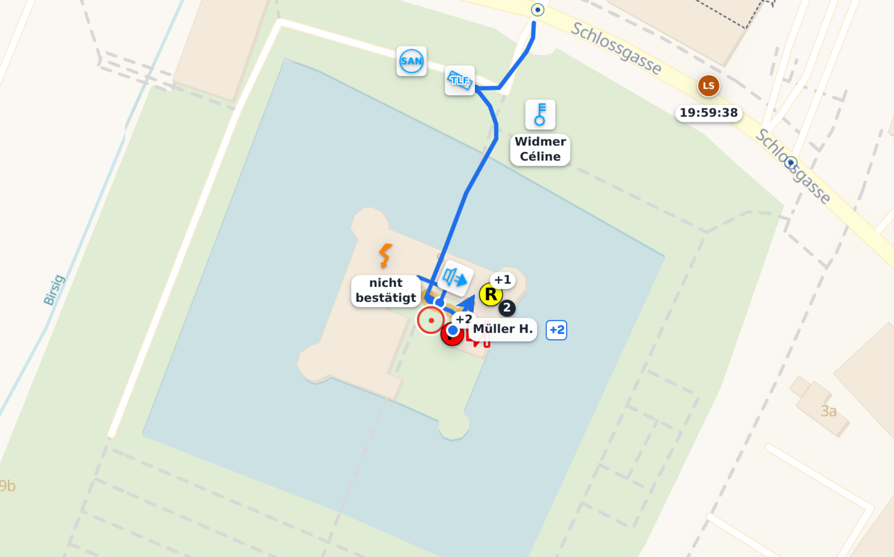
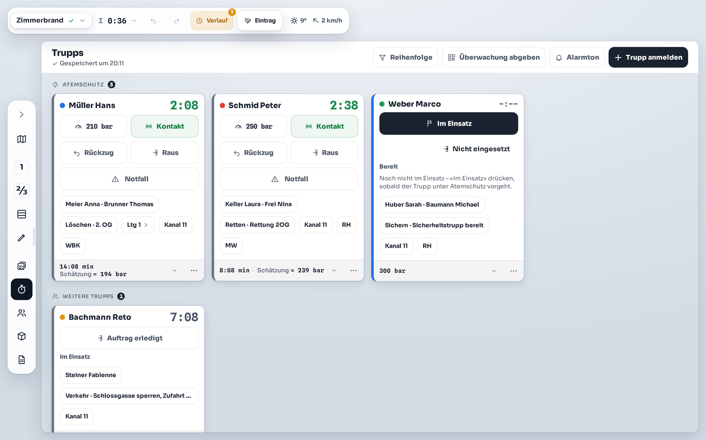
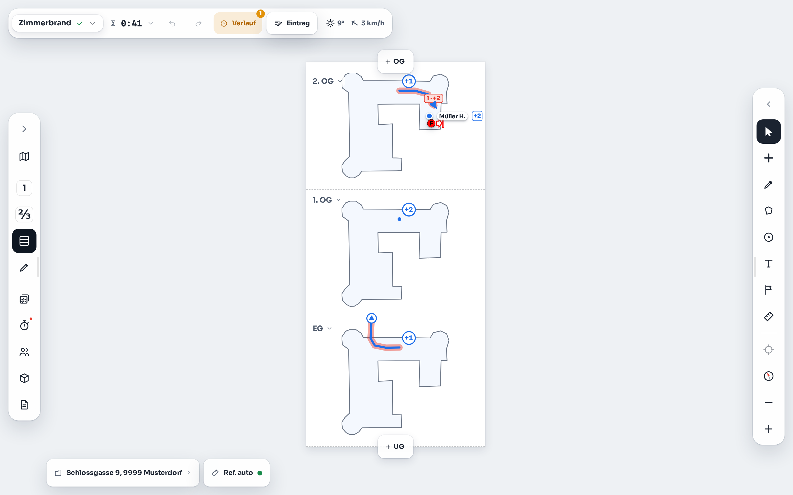
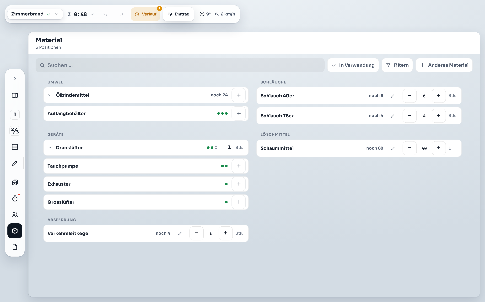
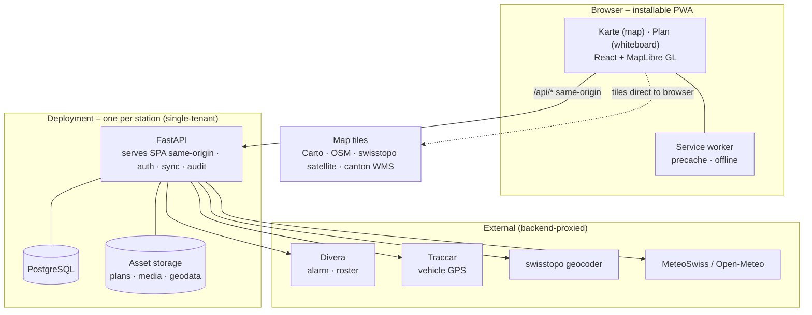

# KP Front

[](https://www.gnu.org/licenses/agpl-3.0)
[](https://github.com/feuerwehr-oberwil/kp-front/actions/workflows/ci.yml)
[](https://demo.kp-front.ch)

**Einsatzführungs-app for frontline fire-service command.** KP Front replaces the physical
Lagekarte and command table with a shared situation map, prepared plans and object data, live
documentation, and an offline-capable record.

One operator runs it on a consumer tablet and can share it with the command point using screen
mirroring or display mode. KP Front owns its incident state, map, timeline, offline cache, and
exports; integrations add data but are not required to operate it.

## Try the demo

The [public demo](https://demo.kp-front.ch) contains a running Zimmerbrand at the
Schloss in fictional Musterdorf. Credentials are shown on the login screen. The demo keeps
your edits during the day and resets nightly (00:00 Europe/Zurich); a daily workflow reloads
the station data – config, geodata and object plans – on top of that.

The repository includes the same synthetic station dataset in
[`examples/demo-data/`](examples/demo-data/). No real station data is bundled.

| Karte – live command picture | Trupps – SCBA teams on the clock |
| --- | --- |
|  |  |
| **Gebäude – floor stack and AGT tracking** | **Material – material use by source** |
|  |  |

## Why KP Front

KP Front grew out of a Swiss Milizfeuerwehr command point. It is designed around **one
station, one incident, one operator**, not scaled down from dispatch-center software.

- **Built for Swiss practice.** FKS-style tactical symbols, swisstopo geocoding and LV95
  coordinates, Carto/OSM/swisstopo-satellite base maps with cantonal WMS layers, and optional
  Divera, Traccar, hydrant, and cadastre data.
- **Offline-first.** Field data is cached, readiness is verified, and edits sync when the
  connection returns.
- **One command surface.** Karte, Plan, Checkliste, Trupps, Anwesenheit, Material, Verlauf,
  and reporting share consistent controls.
- **Made for 3am.** Recognition over recall, safe defaults, large touch targets, and undo for
  mutable actions.
- **Defensible records.** Verlauf and audit events are append-only; corrections become new
  entries.
- **Open and self-hostable.** One AGPL-licensed service per station, with no per-seat licence.

## Highlights

- **Karte:** MapLibre map, tactical symbols, drawing, sectors, radii, notes, photos, and audio.
- **Gebäude-Info:** The building at the Einsatzort – federal GWR and BFE register facts
  (Geschosse, Baujahr, heating energy, Schutzraum, PV) next to the Objekt's own
  **Sofortmassnahmen** and Bemerkungen, cached for offline use. When the building has a hazard,
  Sofortmassnahmen or Bemerkungen, the card opens by itself the first time a device shows the
  Einsatz.
- **Plan:** Image-backed whiteboards with symbols, resources, scale calibration, measurement,
  and georeferencing – pairing a plan to the map with reference points, or approving the
  alignment the station computed ahead of time; one object, drawn on both surfaces.
- **Tafel:** A free sketch board plus pages – the FKS «Erste Führung» poster and the FKS
  Handbuch sheets, filled in like a spreadsheet and printed on the Rapport in their own layout. A
  station can replace the bundled set with its own ([`docs/board-templates.md`](docs/board-templates.md)).
- **Einsatz-Intake:** Guided incident creation from Divera, an address, an object, or the map.
- **Checklisten:** The brigade's own command checklists, phase by phase, with direct jumps to
  the plan, the Verlauf, and the tools – loaded from station data like everything else. Next to
  them, read-only **Anleitungen** (step-by-step guides with pictures, grouped by Gerät) that work
  offline.
- **Trupps:** every Trupp on one board – Atemschutz or not – with its Auftragsliste; AS-Trupps
  add pressure and return estimates, alarms, map links, and the Überwachungs-Log.
- **Atemschutznotfall:** Hold «Notfall» on one Trupp and every device turns it red at the top,
  with a running clock, its last place and Druck, and «Sicherungstrupp einsetzen» as the first
  offer – plus tone, OS notification and Web Push. Raising and ending it land in the Verlauf and
  the Rapport.
- **Anwesenheit:** Divera or manual attendance against the station's Personal roster, and
  assignments. **«Anrückend»** lists who answered the Divera alarm «komme» / «komme nicht»; only
  a «da» tap checks somebody in.
- **Material:** The station's Material catalogue on a stepper list – what was used, from which
  source, with remarks that print on the Rapport.
- **Zeitplan:** Shift planning for long incidents – availability and assignment per person, a
  coverage curve across the span, printable as the «Zeitplan» Führungsformular.
- **Reference data:** ADR lookup, wind, the MeteoSwiss precipitation radar, hydrants, utility
  lines, and Traccar vehicle positions.
- **Verlauf:** Append-only incident journal – entries, Meldungen, photos and voice memos with
  transcripts. An entry can stay open as a **Pendenz** until somebody ticks it off, or carry a
  **Fälligkeit**; a typo can be corrected and the line says that it was.
- **Einsatzrapport:** The station's own Erfassungsblatt, pre-filled from the record and composed
  server-side into a PDF that prints from the device – Verlauf, Aufträge/Pendenzen,
  Atemschutz-Journal, Kroki with a Massstab, the Tafel pages, photos as Beilagen, and the Wehr's
  own forms as a list to tick off. An optional **«Auswertung»** sheet at the end adds key figures
  and a timeline for the debrief.
- **Wiedergabe:** Scrub back through an incident as it unfolded – the map, the Verlauf and the
  attendance at any point in time, from the same append-only record the Rapport is built from.
- **Objektbesuche (optional):** Visit an object without an Einsatz, offline – a station
  checklist, photos and Korrekturvorschläge, a PDF report, and optional filing to SharePoint
  ([`docs/object-visits.md`](docs/object-visits.md)).
- **Statistik-Export:** Aggregate incident data for the annual report, with WinFAP matching –
  see [`docs/STATS-EXPORT.md`](docs/STATS-EXPORT.md).
- **Resilience:** Undo/redo, append-only records, sync status, offline readiness, and day/night UI.

See [`CHANGELOG.md`](CHANGELOG.md) for the feature history. Planned work lives in
[GitHub issues](https://github.com/feuerwehr-oberwil/kp-front/issues) and
[discussions](https://github.com/feuerwehr-oberwil/kp-front/discussions).

## Status

KP Front is in operational use at Feuerwehr Oberwil and under active development. Each
single-tenant deployment supplies its own branding, maps, fleet, doctrine, object plans,
geodata, and checklists.

The [`station data guide`](docs/STATION-DATA.md) shows how to build a field-ready private data
repository from the synthetic example without access to Feuerwehr Oberwil's private data.

Interested in using or contributing to KP Front? Start a
[GitHub discussion](https://github.com/feuerwehr-oberwil/kp-front/discussions) or email
[bastian.eichenberger@feuerwehr-oberwil.ch](mailto:bastian.eichenberger@feuerwehr-oberwil.ch).

## Quick start

**Setting up a station, not hacking on the code? Skip to [Self-host](#self-host)** – this
section is the developer machine.

Recipes use [`just`](https://github.com/casey/just) (`brew install just`). See the
[`justfile`](justfile) for the underlying commands.

### Development stack

```bash
just setup       # install dependencies (once)
just demo-load   # load the optional Musterdorf dataset (starts the DB; migrates first)
just demo-off    # ← run this after demo-load, or you cannot create incidents (see below)
just dev         # PostgreSQL + API (:8001) + frontend (:5188), Ctrl+C stops all
```

> **`just demo-off` is not optional after `just demo-load`.** The demo dataset sets
> `demoMode: true`, which makes `POST /api/incidents` answer **403** — the guard that keeps the
> public demo read-only. On your own machine that just looks like a broken app, so turn it off
> once the data is loaded. Re-run it after every `just demo-load`.

`just dev` is the only command you need day to day – it starts the database, waits for it,
migrates, and runs both servers in one terminal. For the frontend alone (no database, no
backend, built-in demo data): `pnpm dev`.

**Development and demo only:** log in as user `fu` (Führungsunterstützung) with PIN `000000`,
the PIN carried by the bundled `backend/app/seed_users.json`. A self-hosted installation never
gets that PIN: with `ENVIRONMENT=production` the seeder demands its own `SEED_PIN` and refuses
to boot without one, and `000000` – like `123456` and the other well-known PINs – is rejected
outright, whether it arrives as `SEED_PIN` at boot or through the admin UI's PIN sheet
(`backend/app/auth/security.py` · `TRIVIAL_PINS`). Pick a non-obvious `SEED_PIN`, and change it
after the first login.

### Common recipes

Run `just` without an argument to list every recipe.

| Recipe | Purpose |
| --- | --- |
| `just dev` | the whole stack: database + backend + frontend |
| `just db-stop` / `just db-reset` | stop the dev database / wipe its volume |
| `just lint` / `just test` | lint / test both stacks |
| `just build` | type-check + production build |
| `just config-example` | print a starting deployment config (copy & edit) |
| `just config-validate <file>` / `just config-load <file>` | validate / apply a config |
| `just demo-load` | load the synthetic Musterdorf demo dataset (then run `just demo-off`) |
| `just demo-off` | clear `demoMode`, so incidents can be created locally |

The React frontend can run alone. The FastAPI backend adds authentication, workspace sync,
history, integrations, and reference data. Deployment configuration is managed as code; see
[`Configuration`](docs/CONFIGURATION.md) and [`API`](docs/API.md).

## Self-host

The production setup is one application container and PostgreSQL, pulled as a published
image – no build toolchain on the server. Setting up a station for the first time? Follow
[`docs/SETUP.md`](docs/SETUP.md), which walks the whole path in order; the full
[`deployment guide`](docs/DEPLOYMENT.md) is the reference behind it.

```bash
git checkout "$(git tag -l 'v*' --sort=-v:refname | head -n1)"   # newest release, not main
./scripts/setup.sh            # ghcr.io/feuerwehr-oberwil/kp-front:${KP_FRONT_TAG:-latest}
```

`setup.sh` is plain bash and docker – **a station server never needs `just`, `uv` or `pnpm`**,
and the recipes above are the developer toolchain, not the install. It asks for your domain, the
host port and whether to back the station up nightly, checks the port is free *before* anything
starts, generates all four required secrets, waits until the app answers, and then mints the Web
Push pair into the encrypted credential store – so it stays rotatable in `/admin` instead of
frozen in `.env`. Webhook secrets are chosen when an alarm system is connected, so the same
write-only value can be given to both sides. `just self-host` runs the identical script.

**On Railway instead?** Same image, different platform defaults – the volume has to be mounted at
`/mnt/data` and the service needs `RAILWAY_RUN_UID=0`, and both fail before the app serves
anything. The procedure in order is
[`docs/DEPLOYMENT.md` §3a](docs/DEPLOYMENT.md#3a-railway-in-order); `setup.sh` and
`docker-compose.yml` are the compose path only.

**Getting your data in.** A fresh deployment is meant to be run empty – Carto base map, no
layers, no plans, no roster, and nothing errors – then filled in whichever way suits you. There are
three doors, and it is worth knowing which is which:

- **Manifest + `admin_*` CLI, or the same thing one file at a time in the admin UI.** These are
  not alternatives to "the JSON files" – *the manifest is what the CLI reads*. All of them write
  through one code path, so the browser and the CLI mint the same dataset ids and cannot drift.
- **A scheduled pull from an S3-compatible bucket** – no other system needs a credential for this
  one. ⚠️ Covers **object plans only**; geodata and checklists are CLI, UI or SharePoint.
- **A scheduled pull from the station's own SharePoint folders** – Objektpläne, Geodaten,
  Checklisten and the Arbeitsmappe, read-only via Microsoft Graph and fed through the same
  importers as the CLI. See [`docs/sharepoint-connector.md`](docs/sharepoint-connector.md).

All three doors are built in – the S3 pull reads any S3-compatible bucket with a documented index,
not a bridge to some particular product.

Whichever door, the bytes land in **your** deployment's storage and are served from there; a
bucket or SharePoint is a source, not a runtime dependency. WMS layers store nothing at all – the
browser fetches cantonal tiles directly. Roster and incidents are a separate axis, covered by the integrations below.

Oberwil regenerates its manifests nightly from a plan library, but **that pipeline is not part of
this product** – `admin_objects schema` and `admin_objects example` give you the contract, and four
PDFs uploaded by hand once a year is a complete answer. The full walkthrough is
[`docs/SETUP.md` §4](docs/SETUP.md).

Updating is `docker compose pull && docker compose up -d`; migrations run on boot. Pin a
version with `KP_FRONT_TAG` in `.env` and follow the
[releases](https://github.com/feuerwehr-oberwil/kp-front/releases) –
[`CHANGELOG.md`](CHANGELOG.md) explains what a MAJOR/MINOR/PATCH bump means for a deployment.
Doctrine: pin, never `latest`/`main`, and update between incidents, not during one –
[`docs/DEPLOYMENT.md` §5](docs/DEPLOYMENT.md#5-updating).

**Every published image has already run a real fire station.** Feuerwehr Oberwil's production
deployment and the public demo both track `main` continuously; a version tag is a label on a
commit that has been carrying live incidents. Releases exist for *other* stations, not for us.

## Architecture & key decisions

A tablet-first PWA talks to a single FastAPI service that serves the app same-origin, owns the
database and asset store, and is the only thing that reaches external services – one deployment
per station. The one-page overview – every optional integration and the station-data CLIs
included – and the full diagrams (data provenance, backend modules, config layers, sync flow)
are in [`docs/ARCHITECTURE.md`](docs/ARCHITECTURE.md).



**Frontend:** React 19, TypeScript, Vite 8, MapLibre GL, Workbox/PWA, and Vitest. Incident
workspaces persist in IndexedDB and sync with the backend when online.

**Backend:** FastAPI, PostgreSQL, Alembic, and `uv`. It serves the frontend from the same origin
and supports Railway and Docker Compose deployments.

**Configuration layers** (see [`Configuration`](docs/CONFIGURATION.md)):

1. National defaults in code.
2. Per-station configuration in the database.
3. Secrets in environment variables.
4. Per-incident settings in the workspace.

**Deliberate tradeoffs:**

- **Single-tenant:** one station per deployment keeps ownership and isolation simple.
- **Local PIN login, on purpose:** incident roles are `editor` (may mutate incident state), `el`
  (Einsatzleiter – writes only the record) and `viewer` (read-only), authenticated by a PIN held
  in the deployment's own database ([`docs/roles-and-access.md`](docs/roles-and-access.md)). The
  PIN is never replaced by an identity provider – an IdP round-trip is a network dependency on the
  one path that has to work at 3am in a cellar with no signal. An optional «Mit Microsoft
  anmelden» (Entra ID) is a second door onto the same existing accounts: it never creates a user
  or changes a role, and is off unless configured
  ([`docs/microsoft-login.md`](docs/microsoft-login.md)). Deployment administration is separated
  behind its own `ADMIN_SECRET`, fail-closed.
- **Task-scoped sync:** collections merge by item; simultaneous edits to one item use a simple
  conflict model.
- **Append-only history:** operational records are corrected with new events, not rewritten.
- **Verified offline readiness:** the app checks required cached data instead of assuming it is
  available.

**The 3am tenet** – the guiding UX rule across every feature: the operator is an infrequent
expert, under stress, possibly in the dark and offline, who must use this correctly at 3am
after six months without practice. Recognition over recall, right defaults over
configuration, nothing that can't be undone.

## Integrations

Every external service is proxied by the backend – the one deliberate exception is basemap
tiles, which the browser fetches directly so it can cache them (shown in the architecture
diagram); the server fetches tiles itself only to draw the map into its PDFs (Rapport, Tafel
print). Each connector is **optional** – the app runs fully without any of them, and each one
is fail-closed: no credential configured means the feature is off, not degraded. Server-only
secrets (`SECRET_KEY`, `ADMIN_SECRET`, …) stay environment-only; integration credentials (Divera,
Traccar, VAPID, STT, CARTO, webhook secrets, …) are settable from `/admin` and stored encrypted
at rest (AES-256-GCM under a key derived from `SECRET_KEY`) – never plaintext in the database,
and never readable back over the API except CARTO's browser tile key.

| Connector | Direction | Works with today | Adding another |
|-----------|-----------|------------------|----------------|
| **Alarm intake** | in | **Any** alerting system via the open `POST /api/alarms` webhook (idempotent on source + id, auto-opens an incident); native [Divera 24/7](https://www.divera247.com/) and FireHub (Tercero) adapters | Already open – POST the documented JSON, no code needed. See [docs/ALARM-INTEGRATIONS.md](docs/ALARM-INTEGRATIONS.md) |
| **Incident relay** | out | Any endpoint that accepts the incident JSON. The payload is a nested envelope sent without an auth header, so feeding KP Rück's `/api/alarms` needs a short adapter – it is not drop-in | Point a URL at it; the core knows nothing about the receiver |
| **Personnel roster** | in | Divera 24/7, including Qualifikationen mapped to Dienstgrad; or a `roster-snapshot/1` file the station publishes, directly or through a station index (`station-index/1`) | Any tool can write the snapshot – see [docs/CONFIGURATION.md](docs/CONFIGURATION.md) §4c/§4d. Synced identities are stored provider-neutrally (`personnel_external_identities`), so a second source can be added |
| **Vehicle GPS** | in | [Traccar](https://www.traccar.org/) | Currently Traccar-specific – no abstraction yet. It can be generalised the same way as the alarm connectors |
| **Maps & geocoding** | in | swisstopo geocoding (search, LV95); Carto, OpenStreetMap and swisstopo-satellite base maps; cantonal WMS layers | `GEOCODER_URL` plus config-driven reference layers – see [docs/geodata-architecture.md](docs/geodata-architecture.md) |
| **Weather** | in | MeteoSwiss / Open-Meteo (wind for the spread estimate); MeteoSwiss precipitation radar on the Karte | `WEATHER_LAYER_ENABLED=false` turns the map layer off |
| **Speech-to-text** | out | Any OpenAI-compatible `/v1/audio/transcriptions` server – Groq, OpenAI, or a self-hosted faster-whisper | Set `STT_BASE_URL`. Empty means off everywhere, and audio never leaves the instance |
| **Push notifications** | out | Web Push (VAPID) for Atemschutz alarms – including an Atemschutznotfall – and reminders when the app is killed, «Neuer Einsatz» for a new Divera alarm, and «Neuer Objektbesuch» to the accounts an admin picks | Unset keys disable the sweep entirely |
| **Station data** | in | Reference geodata, object plans, checklists, and Tafel pages loaded from a private data repo via `admin_geodata` / `admin_objects` / `admin_checklists` / `admin_board_templates` | GeoJSON must be WGS84. See [docs/STATION-DATA.md](docs/STATION-DATA.md) |
| **SharePoint** | in (out for Objektbesuche) | Microsoft 365 via Graph: a scheduled, read-only pull of Objektpläne, Geodaten, Checklisten and the Arbeitsmappe; optionally, Objektbesuche filed one-way into a SharePoint folder under a separate app registration | Set the `sharepoint_*` credentials and `sharepoint.sources`. See [docs/sharepoint-connector.md](docs/sharepoint-connector.md) |
| **Microsoft login** | in | Optional «Mit Microsoft anmelden» via Entra ID onto existing accounts only – never creates users or changes roles | Set the four `ENTRA_LOGIN_*` credentials (tenant, client, secret, allow-list). See [docs/microsoft-login.md](docs/microsoft-login.md) |
| **Rückmeldung (Telemetrie)** | out | Sanitised crash reports. With no maintainer ingest any more, they are sent **nowhere** unless `KP_TELEMETRY_DSN` points at the station's own GlitchTip/Sentry. **Off by default, and there is no switch in the admin UI** – the consent card was removed on 2026-09-10, so consent stays off unless it is set through the admin API; the deployer can also veto it outright with `KP_TELEMETRY_ENABLED=0` | Point `KP_TELEMETRY_DSN` at your own GlitchTip, or leave it empty. Full detail in [PRIVACY.md](PRIVACY.md) |

New connectors are welcome contributions – the alarm seam is the model to copy.

## Known limitations

- Offline persistence requires IndexedDB; restricted browser modes may fall back to less durable
  storage.
- Simultaneous edits to the same object can overwrite one another.
- Central sign-in is Microsoft Entra ID only, and only on top of the PIN: the optional «Mit
  Microsoft anmelden» signs listed members into their existing named accounts, never creates a
  user and never grants `/admin` (see the tradeoff above and
  [`docs/microsoft-login.md`](docs/microsoft-login.md)). Other identity providers have no path
  today.
- The UI ships in German, French, Italian, and English. All four catalogues are complete and a
  half-translated one fails the build, but German is the canonical one and the other three have
  **not been read by a firefighter who speaks the language** – terminology follows the national
  bodies (CSSP for French) rather than a dictionary, and that choice has not been reviewed. If a
  term reads wrong to you, say so; it gets corrected.

See [GitHub issues](https://github.com/feuerwehr-oberwil/kp-front/issues) for current work.

## Repository layout

```text
src/                       React/Vite frontend
  components/              UI surfaces
  config/                  copy, locale, defaults, and storage keys
  data/                    neutral fallback data
  lib/                     domain logic, offline storage, and sync
backend/                   FastAPI/PostgreSQL service
e2e/                       Playwright smoke + field scenario against the built image
examples/demo-data/        synthetic Musterdorf deployment data
examples/scenarios/        fake-alarm scenarios for `app.fake_scenario`
public/                    tactical symbols and PWA assets
site/                      the public landing page (kp-front.ch), generated
tools/                     symbol generator and source assets
docs/                      product and technical documentation
```

## Documentation

Start with the [`documentation index`](docs/README.md):

- [`Setup`](docs/SETUP.md) – **start here** if you are bringing up a new station: the ordered
  path from an empty host to a deployment you can run an incident on.
- [`Configuration`](docs/CONFIGURATION.md) – deployment configuration and station data.
- [`Station data`](docs/STATION-DATA.md) – build and load a private station-data repository.
- [`Deployment`](docs/DEPLOYMENT.md) – production and self-hosted setup.
- [`Architecture`](docs/ARCHITECTURE.md) – system overview and design decisions.
- [`Privacy`](PRIVACY.md) – what this app does and does not send anywhere. Short answer:
  nothing, until a station switches it on, and there is a switch to make that impossible.

## Related project

KP Front runs the **frontline** command surface – the Lagekarte. If you're looking for the
**rear** command post – a Kanban resource board that replaces the physical magnet board for
tracking personnel, vehicles, materials, and incidents – see its companion
**[KP Rück](https://github.com/feuerwehr-oberwil/kp-rueck)**
([live demo](https://demo.kp-rueck.ch)).

The two grew out of the same brigade and share a design language, but they are **completely
independent** codebases and deployments – neither requires the other. Both accept the same
`POST /api/alarms` payload with the same auth (`?secret=` or `X-Webhook-Secret`); since
2026-08-19 the portable subset is pinned by
[`docs/alarm-intake-conformance.json`](docs/alarm-intake-conformance.json), byte-identical in
both repositories. So a dispatch integration is built once and delivered twice – one webhook per
app, each with its own URL and its own secret. KP Front's outbound incident relay is a different
envelope and still needs an adapter to feed KP Rück, and KP Rück has no outbound webhook to push
the other way. Nothing else connects them – separate databases, separate auth, separate
deployments. See [`docs/ALARM-INTEGRATIONS.md`](docs/ALARM-INTEGRATIONS.md).

**Running both on one host?** Read
[`RUNNING-BOTH.md`](https://github.com/feuerwehr-oberwil/kp-rueck/blob/main/docs/RUNNING-BOTH.md) first. Independent
does not mean they can't collide: both stacks ship a Caddy that wants port 443, both have a
`PUBLIC_URL` that means something different, and the one `/api/alarms` payload still needs two
webhooks with two secrets. Three traps, all silent, all cheaper to read about than to debug.

## Contributing

Contributions are welcome: bug fixes, integrations, translations, or ideas. See
**[CONTRIBUTING.md](CONTRIBUTING.md)** for guidelines.

Need help, or want to know what you can expect from a one-maintainer project before you rely on
it? **[SUPPORT.md](SUPPORT.md)** says so plainly.

## License

KP Front is licensed under the **GNU Affero General Public License v3.0 or later**
(`AGPL-3.0-or-later`) – see [`LICENSE`](LICENSE). You may run, study, share, and modify it; if
you run a modified version as a network service, you must offer your users the modified source.

Copyright © 2026 Bastian Eichenberger.

The AGPL covers the application source and the KP-Front-authored tactical symbol pack.
Station-specific object plans, geodata, and checklists are supplied separately by each
deployment and are not part of this repository.
